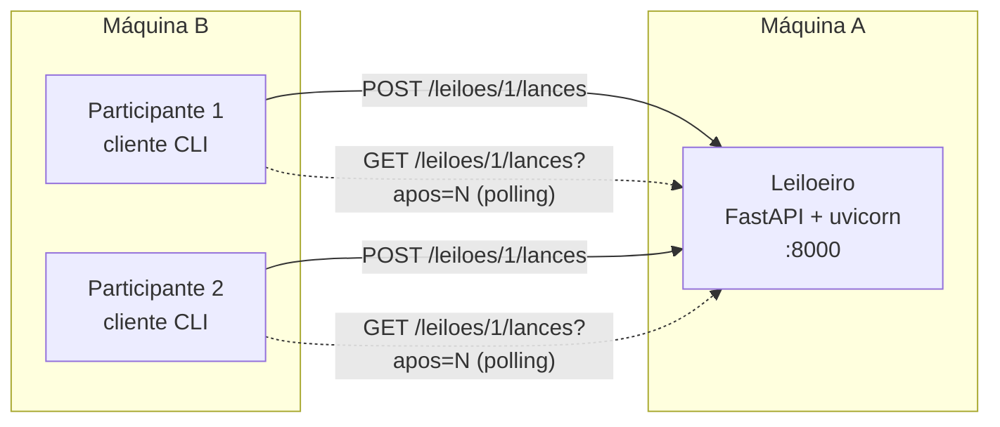

# Leilão Distribuído com REST/RESTful

Projeto prático de **Sistemas Distribuídos e Computação Paralela** (PUC-SP, 2º sem. 2026, Prof. Carlos Paes).
**Tecnologia sorteada (Grupo 7): REST / RESTful.**

**Integrantes:** Caroline Guimarães Campos, Emili Vieira Tabuti, Gustavo Macedo Costa, Isabela Groke Gomes.

> Status: **Entrega 1** (roteiro preliminar + primeira comunicação entre dois processos).
> Os itens marcados com 🔲 serão concluídos no Laboratório 2 (06/11).

---

## 1. Estudo da tecnologia

### 1.1 O que é REST

REST (*Representational State Transfer*) **não é um protocolo nem uma biblioteca**: é um **estilo arquitetural** definido por Roy Fielding (tese de doutorado, 2000). Na prática, é usado sobre HTTP: o servidor expõe **recursos** identificados por URLs e o cliente os manipula por meio de **representações** (aqui, JSON) trocadas com os **verbos HTTP**.

No espectro dos paradigmas da disciplina, REST é **Web Service**: comunicação **síncrona**, **direta** (cliente conhece o endereço do servidor) e por **requisição/resposta**.

### 1.2 Os princípios (restrições) de REST

| Restrição | Significado | Onde aparece no leilão |
|---|---|---|
| Cliente/servidor | Separação de responsabilidades; evoluem independentemente | Participante (CLI) e Leiloeiro (API) só compartilham o contrato HTTP/JSON |
| **Stateless** (sem estado de sessão) | Cada requisição carrega tudo o que o servidor precisa; o servidor não guarda "conversa" com o cliente | O Participante se identifica em **cada** lance; não há login/sessão. O estado do *leilão* existe, o da *sessão* não |
| Cacheável | Respostas declaram se podem ser reaproveitadas | `GET` seguro e idempotente (candidato a cache/ETag, ver extras) |
| **Interface uniforme** | Recursos por URL, verbos com semântica fixa, representações padronizadas, mensagens autodescritivas | `/leiloes/{id}`, `/leiloes/{id}/lances`; códigos de status com significado |
| Sistema em camadas | Cliente não sabe se fala com o servidor final ou com proxy/balanceador | Permite colocar um proxy/Docker na frente sem mudar o cliente |
| Código sob demanda (opcional) | Servidor pode enviar código executável | Não usado |

Pontos de projeto que importam para este trabalho:

- **Substantivos nas URLs, verbos no método.** `POST /leiloes/1/lances` (e não `/darLance`). Um lance é um *recurso* que passa a existir.
- **Semântica dos verbos:** `GET` é *seguro* e *idempotente*; `POST` **não** é idempotente (repetir um POST cria outro lance); `PUT`/`DELETE` são idempotentes.
- **Códigos de status fazem parte do contrato:** `201 Created` (lance aceito), `409 Conflict` (conflito com o estado atual: lance baixo ou leilão encerrado), `404`, `422` (corpo inválido).
- **Modelo de maturidade de Richardson:** nível 0 (RPC sobre HTTP) → 1 (recursos) → 2 (verbos + status) → 3 (HATEOAS, links na resposta). A POC mira o **nível 2**, que é o que a maioria das APIs "REST" na prática entrega.

### 1.3 Como REST resolve o cenário do leilão (e sua limitação central)

O cenário combina **requisição/resposta** e **notificação**:

- *Dar lance e saber se foi aceito* → encaixa perfeitamente em REST (`POST` + status).
- *Ficar sabendo dos lances dos outros* → **REST não tem push**: o servidor nunca inicia a comunicação. O Participante precisa fazer **polling** (consultas periódicas).

Esta é a diferença que destacaremos no seminário frente a WebSocket, gRPC (streaming) e MOM (pub/sub): em REST o **cliente puxa**, e isso custa em **latência de notificação** (até 1 intervalo de polling) e em **requisições desperdiçadas**. Mitigações: *polling incremental* (`?apos=seq`, adotado), `ETag`/`304 Not Modified`, *long polling*; e fora do REST puro: SSE, WebSocket, webhooks.

### 1.4 Vantagens, desvantagens e casos de uso

| Vantagens | Desvantagens |
|---|---|
| Simples, universal (qualquer linguagem com HTTP), fácil de depurar (`curl`, navegador) | Sem push nativo → polling |
| Baixo acoplamento; contrato por URL/JSON; evolui por versionamento | Verboso (JSON textual, HTTP/1.1 por requisição) vs. gRPC/Protobuf |
| Stateless → escala horizontalmente atrás de balanceador | Sem contrato formal forte por padrão (OpenAPI resolve parcialmente) |
| Aproveita infraestrutura HTTP (cache, proxy, TLS, gateways) | "Quem foi primeiro" e concorrência ficam a cargo do servidor |

**Casos de uso reais:** APIs públicas do GitHub, Stripe, Twilio, Google Maps e a maioria das APIs de e-commerce/pagamento. 🔲 *Conferir cada exemplo na documentação oficial antes do seminário (regra de verificação da Seção 9 da especificação).*

**Ferramentas:** FastAPI (escolhido), Flask, Spring Boot, Express; OpenAPI/Swagger; Postman/curl.

---

## 2. Design da POC

### 2.1 Arquitetura



- **Quem inicia a comunicação:** sempre o Participante (cliente). O Leiloeiro nunca fala primeiro.
- **Leiloeiro** ([leiloeiro/main.py](leiloeiro/main.py)): guarda o leilão e a lista de lances **em memória**; valida e aplica cada lance dentro de um `Lock`.
- **Participante** ([participante/cliente.py](participante/cliente.py)): CLI com `consultar`, `lance` e `acompanhar` (polling).
- Linguagem: Python 3.12; transporte: HTTP/1.1; formato: JSON.

### 2.2 Decisões de design (e o porquê)

1. **Encerramento calculado sob demanda.** Não há *timer*: o estado é `ENCERRADO` se `agora >= encerra_em`. Evita corrida entre timer e lance e simplifica o servidor.
2. **Relógio do servidor é a autoridade.** Só o Leiloeiro decide se o leilão fechou e quando cada lance chegou (`recebido_em`). Participantes não enviam horário. (Gancho da aula de sincronização de relógios.)
3. **Ordem total por `seq`.** Cada lance aceito recebe um número sequencial; o polling usa `?apos=seq` e nunca perde nem repete lances.
4. **Lance recusado = `409 Conflict`**, não erro do cliente (`400`): o pedido é válido, mas conflita com o estado atual. O corpo explica o motivo.
5. **Concorrência:** a verificação "valor > maior atual" e a gravação ocorrem sob o mesmo `Lock`; de dois lances simultâneos, o **primeiro a obter o lock** vence e o outro recebe `409`. (Será medido em RE3.)
6. **Um item/leilão por execução** (parâmetros na linha de comando), mas o recurso já é `/leiloes/{id}`, então vários leilões é uma extensão natural.

### 2.3 Contrato da API e formato das mensagens (RF6)

| Operação | Requisição | Resposta |
|---|---|---|
| Consultar leilão (RF2) | `GET /leiloes/1` | `200` estado |
| Dar lance (RF3) | `POST /leiloes/1/lances` | `201` aceito / `409` recusado |
| Novos lances (RF4, polling) | `GET /leiloes/1/lances?apos=N` | `200` lista incremental |

**Consultar leilão** → `200 OK`
```json
{
  "id": 1,
  "item": "Notebook usado",
  "lance_minimo": 100.0,
  "maior_lance": {"seq": 2, "participante": "Bia", "valor": 200.0, "recebido_em": "2026-10-30T13:04:30.798543+00:00"},
  "encerra_em": "2026-10-30T13:04:42.000000+00:00",
  "tempo_restante_s": 10.7,
  "status": "ABERTO",
  "vencedor": null
}
```
`vencedor` só é preenchido quando `status` é `ENCERRADO` (RF5).

**Dar lance** — corpo da requisição:
```json
{"participante": "Ana", "valor": 150.0}
```
Aceito → `201 Created` + cabeçalho `Location: /leiloes/1/lances/1`
```json
{"aceito": true, "lance": {"seq": 1, "participante": "Ana", "valor": 150.0, "recebido_em": "..."}}
```
Recusado → `409 Conflict`
```json
{"detail": {"aceito": false, "motivo": "LANCE_INSUFICIENTE", "maior_lance_atual": 150.0, "lance_minimo": 100.0}}
```
```json
{"detail": {"aceito": false, "motivo": "LEILAO_ENCERRADO"}}
```

**Novos lances** → `200 OK`
```json
{"lances": [{"seq": 3, "participante": "Ana", "valor": 250.0, "recebido_em": "..."}], "status": "ABERTO"}
```

A documentação interativa (OpenAPI) é gerada automaticamente em `http://<leiloeiro>:8000/docs`.

### 2.4 Mapa de requisitos

| Requisito | Situação | Como |
|---|---|---|
| RF1 1 Leiloeiro + ≥2 Participantes, processos distintos | ✅ Entrega 1 (testado com 2 processos) | Servidor + CLI executados separadamente |
| RF2 Estado do leilão | ✅ | `GET /leiloes/1` |
| RF3 Lance aceito/recusado | ✅ | `POST` → `201`/`409` |
| RF4 Notificação | 🟡 `acompanhar` implementado, falta validar com ≥2 participantes | Polling com `?apos=` |
| RF5 Encerramento e vencedor | ✅ | Campo `vencedor` + recusa com `LEILAO_ENCERRADO` |
| RF6 Formato das mensagens | ✅ | Seção 2.3 |
| RE1 Duas máquinas | 🔲 Lab 2 (testar com `--url http://IP:8000`) | |
| RE2 Experimento de falha | 🔲 Lab 2 | Seção 5 |
| RE3 Experimento de concorrência | 🔲 Lab 2 | Seção 5 |
| RE4 Repositório + README | ✅ (README será completado) | |

---

## 3. Primeira comunicação entre dois processos

Já funciona: um Participante envia um lance, o Leiloeiro responde **aceito/recusado**. Saída real do teste (leilão de 15 s, mínimo 100):

```
$ python participante/cliente.py lance Ana 50
RECUSADO: {'aceito': False, 'motivo': 'LANCE_INSUFICIENTE', 'maior_lance_atual': None, 'lance_minimo': 100.0}
$ python participante/cliente.py lance Ana 150
ACEITO: {'seq': 1, 'participante': 'Ana', 'valor': 150.0, ...}
$ python participante/cliente.py lance Bia 150
RECUSADO: {'aceito': False, 'motivo': 'LANCE_INSUFICIENTE', 'maior_lance_atual': 150.0, ...}
$ python participante/cliente.py lance Bia 200
ACEITO: {'seq': 2, 'participante': 'Bia', 'valor': 200.0, ...}
(após o encerramento)
$ python participante/cliente.py lance Ana 999
RECUSADO: {'aceito': False, 'motivo': 'LEILAO_ENCERRADO'}
$ python participante/cliente.py consultar
[ENCERRADO] Notebook usado | mínimo: 100.0 | restante: 0.0s
  maior lance: 200.0 por Bia
  VENCEDOR: Bia
```

---

## 4. Como executar

Requisitos: Python 3.10+.

```bash
git clone <URL-DO-REPOSITORIO> && cd <repositorio>
python3 -m venv .venv
source .venv/bin/activate            # Windows: .venv\Scripts\activate
pip install -r requirements.txt
```

**Máquina A (Leiloeiro):**
```bash
python leiloeiro/main.py --item "Notebook usado" --minimo 100 --duracao 120 --port 8000
```
Descubra o IP da máquina (`hostname -I`) e libere a porta 8000 no firewall, se necessário.

**Máquina B (Participantes, um terminal cada):**
```bash
python participante/cliente.py --url http://IP_DA_MAQUINA_A:8000 acompanhar
python participante/cliente.py --url http://IP_DA_MAQUINA_A:8000 consultar
python participante/cliente.py --url http://IP_DA_MAQUINA_A:8000 lance Ana 150
```
Sem `--url`, o padrão é `http://localhost:8000`.

Teste rápido sem o cliente: `curl -X POST localhost:8000/leiloes/1/lances -H 'Content-Type: application/json' -d '{"participante":"Ana","valor":150}'`

---

## 5. Experimentos (Laboratório 2) 🔲

**RE2 – Falha.** Plano: derrubar o Leiloeiro (Ctrl+C) durante o leilão e observar os Participantes; reiniciar.
Hipóteses a verificar: (a) `acompanhar` imprime "Leiloeiro indisponível" e continua tentando (o cliente é tolerante, o servidor não); (b) como o estado está **em memória**, ao reiniciar o leilão **recomeça do zero e o maior lance é perdido**. Decisão em aberto: persistir em arquivo JSON para preservar o estado.
Resultado observado: _a preencher_.

**RE3 – Concorrência.** Plano: dois Participantes disparam o mesmo valor ao mesmo tempo (ex.: dois `curl` em paralelo ou script com threads). Hipótese: exatamente um recebe `201` e o outro `409`, pela serialização do `Lock`; "quem foi primeiro" é decidido pelo servidor, não pelo relógio do cliente.
Resultado observado: _a preencher_.

---

## 6. Divisão de tarefas (proposta, ajustar no grupo)

| Integrante | Responsabilidade principal | Entregas |
|---|---|---|
| Emili Vieira Tabuti | **Leiloeiro** (API FastAPI, regras de lance, encerramento) | `leiloeiro/`, persistência opcional |
| Gustavo Macedo Costa | **Participante** (CLI, polling, tratamento de falha) | `participante/`, reconexão |
| Isabela Groke Gomes | **Experimentos RE2/RE3** + testes em 2 máquinas (RE1) + vídeo plano B | Seção 5, script de concorrência |
| Caroline Guimarães Campos | **Estudo e slides** (partes 1, 2 e 7), diagrama, `IA.md` | Seção 1, slides |

Todos devem conseguir explicar qualquer parte do código (regra da Seção 9): fazer **revisão cruzada** do código uns dos outros antes do seminário.

## 7. Roteiro até o seminário

| Quando | Meta |
|---|---|
| Lab 1 (30/10) | Estudo, design, primeira comunicação, repositório e este README (**Entrega 1**) |
| Lab 2, 0–45 min | Validar RF4 com 2+ participantes; testar em 2 máquinas (RE1); decidir sobre persistência |
| Lab 2, 45–60 min | Rodar e documentar RE2 e RE3; gravar vídeo plano B |
| Lab 2, 60–90 min | Completar README (seção 5), `IA.md` e slides (**Entrega 2**) |
| 13/11 | Seminário: 10 min + 2 min de perguntas, todos participam |

Extras opcionais se sobrar tempo: medir latência entre lance e notificação (depende do intervalo de polling), reconexão automática, Docker, interface web.

## 8. Estrutura do repositório

```
leiloeiro/main.py        servidor REST
participante/cliente.py  cliente CLI
requirements.txt
IA.md                    registro do uso de IA
README.md
```
Slides (.pptx/.pdf) serão adicionados em `slides/`.
