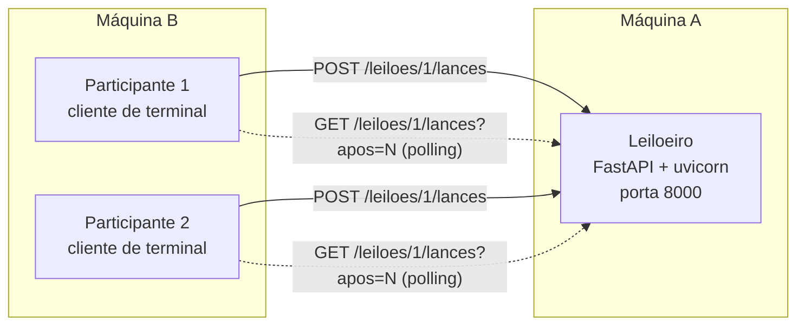

# Leilão Distribuído com REST

Projeto de **Sistemas Distribuídos e Computação Paralela** (PUC-SP, 2º semestre de 2026, Prof. Carlos Paes).
**Tecnologia sorteada para o Grupo 7: REST / RESTful.**

**Integrantes:** Caroline Guimarães Campos, Emili Vieira Tabuti, Gustavo Macedo Costa, Isabela Groke Gomes.

> **Situação:** Entrega 1 (roteiro preliminar e primeira comunicação entre dois processos).
> O que está marcado com [ ] ainda vamos fazer no Laboratório 2 (06/11).

---

## 1. Estudo da tecnologia

### 1.1 O que é REST

REST (*Representational State Transfer*) **não é um protocolo nem uma biblioteca**. É um **jeito de organizar** a comunicação entre sistemas, ou seja, um estilo de arquitetura. Ele foi proposto por Roy Fielding na [tese de doutorado dele, em 2000](https://ics.uci.edu/~fielding/pubs/dissertation/rest_arch_style.htm).

Na prática, o REST usa o HTTP (o mesmo da web). O servidor mostra **recursos** (coisas como "leilão" ou "lance"), cada um com sua URL. O cliente usa os **verbos HTTP** (GET, POST...) para ler ou criar esses recursos, trocando dados em JSON.

Dentro do que vimos na disciplina, o REST é um **Web Service**. A comunicação é **síncrona** (o cliente manda e espera a resposta), **direta** (o cliente conhece o endereço do servidor) e do tipo **requisição/resposta**.

### 1.2 Os princípios do REST

| Princípio | O que quer dizer | Como aparece no nosso leilão |
|---|---|---|
| Cliente/servidor | Cada lado cuida do seu trabalho e os dois podem mudar sem afetar o outro | O Participante e o Leiloeiro só combinam o formato das requisições e do JSON |
| **Sem estado (stateless)** | Cada requisição leva tudo o que o servidor precisa. O servidor não guarda "sessão" do cliente | O participante manda o nome em cada lance. Não existe login |
| Cache | As respostas podem dizer se dá para reaproveitar | O `GET` não altera nada, então poderia usar cache |
| **Interface uniforme** | URLs para recursos, verbos com significado fixo e códigos de status padronizados | `/leiloes/1` e `/leiloes/1/lances`, com `201`, `409` etc. |
| Camadas | O cliente não sabe se está falando direto com o servidor ou com um proxy no meio | Dá para colocar um proxy ou Docker na frente sem mudar o cliente |
| Código sob demanda (opcional) | O servidor pode mandar código para o cliente executar | Não usamos |

Coisas importantes de design que vamos seguir:

- **Substantivo na URL, ação no verbo.** Usamos `POST /leiloes/1/lances` ("cria um lance") e não `/darLance`.
- **Verbos:** `GET` só lê e pode ser repetido sem problema (idempotente). `POST` **não** é idempotente: se repetir, cria outro lance. `PUT` e `DELETE` são idempotentes.
- **Os códigos de status fazem parte do contrato:** `201 Created` (lance aceito), `409 Conflict` (lance recusado porque conflita com o estado atual), `404` (não achou), `422` (JSON inválido).
- **[Modelo de maturidade de Richardson](https://martinfowler.com/articles/richardsonMaturityModel.html):** nível 0 (só HTTP como túnel), 1 (recursos), 2 (verbos e status corretos), 3 (links nas respostas, o HATEOAS). A nossa POC fica no **nível 2**, que é o que a maioria das APIs "REST" usa de verdade.

### 1.3 Como o REST resolve o leilão, e o problema dele

O leilão tem dois tipos de interação:

- **Dar um lance e saber se foi aceito:** combina muito bem com REST (`POST` e o status da resposta).
- **Ficar sabendo dos lances dos outros:** aqui o REST tem uma limitação. **O servidor nunca começa a conversa**, então não existe "push". O participante precisa **perguntar de tempos em tempos** (isso se chama *polling*).

Esse é o ponto que vamos destacar no seminário em comparação com WebSocket, gRPC (streaming) e MOM (publish/subscribe). No REST, **quem puxa a informação é o cliente**. O custo disso é que a notícia pode demorar até um intervalo de polling para chegar, e muitas perguntas voltam sem novidade.

Formas de melhorar: pedir só os lances novos (`?apos=seq`, que vamos usar), `ETag`/`304 Not Modified`, *long polling*. Fora do REST puro existem SSE, WebSocket e webhooks.

### 1.4 Vantagens, desvantagens e onde é usado

| Vantagens | Desvantagens |
|---|---|
| Simples e funciona em qualquer linguagem que fale HTTP | Não tem push, só polling |
| Fácil de testar (`curl`, navegador) | JSON em texto é mais pesado que o Protocol Buffers do gRPC |
| Pouco acoplamento: o contrato é só URL + JSON | O contrato não é tão rígido quanto um WSDL ou um `.proto` (o OpenAPI ajuda) |
| Sem estado, então é fácil escalar com vários servidores | Quem decide a ordem dos lances e a concorrência é o servidor |
| Aproveita o que já existe do HTTP (cache, proxy, TLS) | |

**Quem usa:** as APIs públicas do [GitHub](https://docs.github.com/en/rest), [Stripe](https://docs.stripe.com/api), [Twilio](https://www.twilio.com/docs/usage/api) e [Google Maps](https://developers.google.com/maps/documentation), além de muitas APIs de e-commerce e pagamento. [ ] *Conferir cada exemplo na documentação oficial antes do seminário (regra da Seção 9 do enunciado).*

**Ferramentas:** [FastAPI](https://fastapi.tiangolo.com/) (a que escolhemos), Flask, Spring Boot, Express, [OpenAPI](https://spec.openapis.org/oas/latest.html)/Swagger, Postman e curl.

---

## 2. Design da POC

### 2.1 Arquitetura



- **Quem começa a conversa:** sempre o Participante (o cliente). O Leiloeiro nunca fala primeiro.
- **Leiloeiro** ([leiloeiro/main.py](leiloeiro/main.py)): guarda o leilão e os lances **na memória** e usa um `Lock` para tratar um lance de cada vez.
- **Participante** ([participante/cliente.py](participante/cliente.py)): programa de terminal com os comandos `consultar`, `lance` e `acompanhar` (polling).
- Linguagem: Python 3.12. Transporte: HTTP. Formato dos dados: JSON.

### 2.2 Decisões que tomamos (e por quê)

1. **O fim do leilão é calculado na hora.** Não tem timer: se a hora atual passou da hora de encerramento, o leilão está `ENCERRADO`. Isso evita bug de timer disputando com um lance.
2. **Vale o relógio do servidor.** Só o Leiloeiro decide se o leilão acabou e a que horas cada lance chegou (`recebido_em`). O participante não manda horário. Isso liga com a aula de sincronização de relógios.
3. **Cada lance aceito ganha um número de ordem (`seq`).** O polling usa `?apos=seq`, então o participante não perde nem repete lances.
4. **Lance recusado volta como `409 Conflict`** e não `400`. O pedido está escrito certo, mas conflita com o estado atual do leilão. O corpo da resposta explica o motivo.
5. **Concorrência:** conferir "o valor é maior que o atual?" e salvar o lance acontecem juntos dentro de um `Lock`. Se dois lances chegam ao mesmo tempo, **o primeiro que pegar o lock ganha** e o outro recebe `409`. Vamos medir isso no RE3.
6. **Um leilão por execução** (configurado por parâmetros), mas a URL já é `/leiloes/{id}`, então dá para ter vários leilões depois.

### 2.3 API e formato das mensagens (RF6)

| Operação | Requisição | Resposta |
|---|---|---|
| Consultar o leilão (RF2) | `GET /leiloes/1` | `200` com o estado |
| Dar lance (RF3) | `POST /leiloes/1/lances` | `201` aceito ou `409` recusado |
| Ver lances novos (RF4, polling) | `GET /leiloes/1/lances?apos=N` | `200` com a lista de novos |

**Consultar o leilão** devolve `200 OK`:
```json
{
  "id": 1,
  "item": "Notebook usado",
  "lance_minimo": 100.0,
  "maior_lance": {"seq": 2, "participante": "Bia", "valor": 200.0, "recebido_em": "2026-10-30T13:04:30.798543+00:00"},
  "encerra_em": "2026-10-30T13:04:42.000000+00:00",
  "tempo_restante_s": 10.7,
  "status": "ABERTO",
  "vencedor": null
}
```
O campo `vencedor` só vem preenchido quando o `status` é `ENCERRADO` (RF5).

**Dar lance.** O corpo da requisição é:
```json
{"participante": "Ana", "valor": 150.0}
```
Se aceito, volta `201 Created` com o cabeçalho `Location: /leiloes/1/lances/1`:
```json
{"aceito": true, "lance": {"seq": 1, "participante": "Ana", "valor": 150.0, "recebido_em": "..."}}
```
Se recusado, volta `409 Conflict`:
```json
{"detail": {"aceito": false, "motivo": "LANCE_INSUFICIENTE", "maior_lance_atual": 150.0, "lance_minimo": 100.0}}
```
```json
{"detail": {"aceito": false, "motivo": "LEILAO_ENCERRADO"}}
```

**Ver lances novos** devolve `200 OK`:
```json
{"lances": [{"seq": 3, "participante": "Ana", "valor": 250.0, "recebido_em": "..."}], "status": "ABERTO"}
```

O FastAPI gera sozinho uma documentação interativa (OpenAPI) em `http://<ip-do-leiloeiro>:8000/docs`.

### 2.4 Requisitos do enunciado

| Requisito | Situação | Como |
|---|---|---|
| RF1: 1 Leiloeiro e 2 ou mais Participantes em processos separados | OK (testamos com 2 processos) | Servidor e cliente rodam em terminais diferentes |
| RF2: ver o estado do leilão | OK | `GET /leiloes/1` |
| RF3: dar lance (aceito/recusado) | OK | `POST` com `201` ou `409` |
| RF4: notificação | Em andamento: o `acompanhar` existe, falta testar com 2 ou mais participantes | Polling com `?apos=` |
| RF5: encerramento e vencedor | OK | Campo `vencedor` e recusa com `LEILAO_ENCERRADO` |
| RF6: formato das mensagens | OK | Seção 2.3 |
| RE1: rodar em 2 máquinas | [ ] Lab 2 | Usar `--url http://IP:8000` |
| RE2: experimento de falha | [ ] Lab 2 | Seção 5 |
| RE3: experimento de concorrência | [ ] Lab 2 | Seção 5 |
| RE4: repositório com README | OK (README ainda vai ser completado) | |

---

## 3. Primeira comunicação entre dois processos

Já funciona: um Participante manda um lance e o Leiloeiro responde se foi **aceito ou recusado**. Esta é a saída do nosso teste (leilão de 15 segundos, lance mínimo 100):

```
$ python participante/cliente.py lance Ana 50
RECUSADO: {'aceito': False, 'motivo': 'LANCE_INSUFICIENTE', 'maior_lance_atual': None, 'lance_minimo': 100.0}
$ python participante/cliente.py lance Ana 150
ACEITO: {'seq': 1, 'participante': 'Ana', 'valor': 150.0, ...}
$ python participante/cliente.py lance Bia 150
RECUSADO: {'aceito': False, 'motivo': 'LANCE_INSUFICIENTE', 'maior_lance_atual': 150.0, ...}
$ python participante/cliente.py lance Bia 200
ACEITO: {'seq': 2, 'participante': 'Bia', 'valor': 200.0, ...}
(depois que o leilão acabou)
$ python participante/cliente.py lance Ana 999
RECUSADO: {'aceito': False, 'motivo': 'LEILAO_ENCERRADO'}
$ python participante/cliente.py consultar
[ENCERRADO] Notebook usado | mínimo: 100.0 | restante: 0.0s
  maior lance: 200.0 por Bia
  VENCEDOR: Bia
```

---

## 4. Como executar

Precisa de Python 3.10 ou mais novo.

```bash
git clone https://github.com/emilitabuti/rest.git && cd rest
python3 -m venv .venv
source .venv/bin/activate            # no Windows: .venv\Scripts\activate
pip install -r requirements.txt
```

**Máquina A (Leiloeiro):**
```bash
python leiloeiro/main.py --item "Notebook usado" --minimo 100 --duracao 120 --port 8000
```
Veja o IP da máquina com `hostname -I`. Se precisar, libere a porta 8000 no firewall.

**Máquina B (Participantes, um terminal para cada):**
```bash
python participante/cliente.py --url http://IP_DA_MAQUINA_A:8000 acompanhar
python participante/cliente.py --url http://IP_DA_MAQUINA_A:8000 consultar
python participante/cliente.py --url http://IP_DA_MAQUINA_A:8000 lance Ana 150
```
Se não colocar `--url`, ele usa `http://localhost:8000`.

Também dá para testar sem o cliente, só com o curl:
`curl -X POST localhost:8000/leiloes/1/lances -H 'Content-Type: application/json' -d '{"participante":"Ana","valor":150}'`

---

## 5. Experimentos (Laboratório 2) [ ]

**RE2: falha.** Vamos derrubar o Leiloeiro (Ctrl+C) no meio do leilão, ver o que acontece com os participantes e depois ligar de novo.
O que a gente espera: (a) o `acompanhar` mostra "Leiloeiro indisponível" e continua tentando, ou seja, o cliente aguenta a queda; (b) como os dados ficam **só na memória**, ao reiniciar o leilão **começa do zero e o maior lance se perde**. Ainda precisamos decidir se vamos salvar o estado em um arquivo JSON para não perder.
Resultado que observamos: _a preencher_.

**RE3: concorrência.** Dois participantes dão o mesmo lance ao mesmo tempo (dois `curl` em paralelo ou um script com threads). A gente espera que exatamente um receba `201` e o outro `409`, porque o `Lock` faz um de cada vez. Quem foi primeiro é decidido pelo servidor, não pelo relógio do cliente.
Resultado que observamos: _a preencher_.

---

## 6. Divisão de tarefas (proposta, o grupo pode ajustar)

| Integrante | Responsabilidade principal | Entregas |
|---|---|---|
| Emili Vieira Tabuti | **Leiloeiro** (API, regras de lance, encerramento) | `leiloeiro/`, persistência (se decidirmos fazer) |
| Isabela Groke Gomes | **Participante** (cliente de terminal, polling, tratamento de falha) | `participante/`, reconexão |
| Gustavo Macedo Costa | **Experimentos RE2 e RE3**, teste em 2 máquinas (RE1) e vídeo de plano B | Seção 5, script de concorrência |
| Caroline Guimarães Campos | **Estudo e slides** (partes 1, 2 e 7), diagrama e `IA.md` | Seção 1, slides |

Todo mundo precisa saber explicar qualquer parte do código (regra da Seção 9 do enunciado). Por isso vamos **revisar o código uns dos outros** antes do seminário.

## 7. Roteiro até o seminário

| Quando | O que fazer |
|---|---|
| Lab 1 (30/10) | Estudo, design, primeira comunicação, repositório e este README (**Entrega 1**) |
| Lab 2, 0 a 45 min | Testar o RF4 com 2 ou mais participantes, rodar em 2 máquinas (RE1) e decidir sobre salvar o estado |
| Lab 2, 45 a 60 min | Fazer e anotar o RE2 e o RE3, gravar o vídeo de plano B |
| Lab 2, 60 a 90 min | Completar o README (seção 5), o `IA.md` e os slides (**Entrega 2**) |
| 13/11 | Seminário: 10 min de apresentação e 2 min de perguntas, todo mundo apresenta |

Extras, se sobrar tempo: medir o tempo entre o lance e a notificação (depende do intervalo de polling), reconexão automática, Docker e interface web.

## 8. Referências

- Fielding, R. T. [*Architectural Styles and the Design of Network-based Software Architectures*](https://ics.uci.edu/~fielding/pubs/dissertation/rest_arch_style.htm) (2000), cap. 5: REST.
- [RFC 9110: HTTP Semantics](https://www.rfc-editor.org/rfc/rfc9110) (métodos, idempotência e códigos de status).
- Fowler, M. [Richardson Maturity Model](https://martinfowler.com/articles/richardsonMaturityModel.html).
- [FastAPI](https://fastapi.tiangolo.com/) e [OpenAPI Specification](https://spec.openapis.org/oas/latest.html).
- Exemplos de APIs REST: [GitHub](https://docs.github.com/en/rest), [Stripe](https://docs.stripe.com/api), [Twilio](https://www.twilio.com/docs/usage/api), [Google Maps](https://developers.google.com/maps/documentation).
- Slides da disciplina (Prof. Carlos Paes); Coulouris et al., *Sistemas Distribuídos: conceitos e projeto*, 5. ed.; Tanenbaum e Van Steen, *Sistemas Distribuídos: princípios e paradigmas*, 2. ed.

## 9. Estrutura do repositório

```
leiloeiro/main.py        servidor REST
participante/cliente.py  cliente de terminal
requirements.txt         dependências
IA.md                    registro do uso de IA
README.md                este arquivo
```
Os slides (.pptx ou .pdf) vão ficar na pasta `slides/`.
